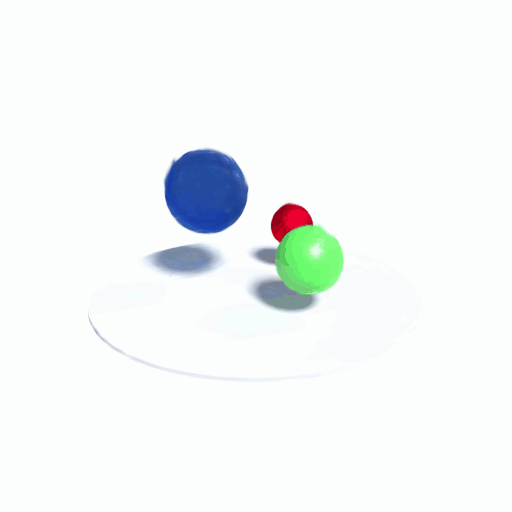

# 4D Gaussian splats
{: .no_toc }

Train dynamic Gaussian splats from posed, timestamped images, export them to a `.4dgs` playback file,
and render seamlessly looping orbit animations.
{: .fs-5 .fw-300 }



1. TOC
{:toc}

---

{: .note }
> 4D support is part of the Gaussian module (`RIEMANN_ENABLE_GAUSSIAN=ON`, the default). The static 3D
> containers, cameras, renderer and trainer it builds on are described in [Gaussian splats](./gaussian.md).

## At a glance

| Stage | API / tool | Bouncingballs result |
|---|---|---|
| Train | `Gaussian4DModel`, `Gaussian4DTrainer`, `load_dnerf_views` | 150 frames at 800x800, 30,000 steps |
| Reconstruct | `reconstruct4d` runner | 99,077 Gaussians; test PSNR 34.91 dB, SSIM 0.9882, L1 0.0038 (about 13.9 min on an RTX 3080) |
| Export | `save_four_dgs` / `--export-only` | 6.5 MB `.4dgs`, 25 chunks, reference validator: no findings |
| Play | `examples/view_fourdgs.py` | Interactive orbit/pan/zoom and a seamless 6 s looping orbit GIF |

## Model

`Gaussian4DModel` represents a Gaussian over space and time in conditional form.
It extends the six raw 3DGS parameter tensors with `velocity [N,3]`,
`time_center [N,1]` and `time_scale_raw [N,1]` (log temporal standard deviation).
For a capture time `t`, rendering uses:

```text
position(t) = xyz + velocity * (t - time_center)
opacity(t)  = sigmoid(opacity_raw)
              * exp(-0.5 * ((t - time_center) / exp(time_scale_raw))^2)
```

The spatial scales and quaternion describe the conditional 3D covariance.
Together with velocity and temporal variance this parameterizes a full
positive-definite space-time covariance, without a separate 4D rotation:
`cov(x,t) = velocity * var(t)` and
`cov(x,x) = cov(x|t) + velocity * var(t) * velocity^T`.
Appearance uses the existing spatial SH coefficients.

Each primitive moves **linearly**, with a Gaussian temporal window. Multiple
time-local primitives can approximate nonlinear motion, but this is not a
deformation network, time-dependent SH model, or a reproduction of a specific
4DGS paper. Densification splits/clones spatial primitives and preserves their
temporal parameters; it does not explicitly split time windows.

## D-NeRF / Blender datasets

The loader reads `transforms_train.json`, `transforms_val.json` or
`transforms_test.json`, including each frame's `file_path`, `time` and
`transform_matrix`, and the top-level `camera_angle_x`. Missing `time` means
zero, allowing static NeRF-synthetic datasets. JSON is parsed with the vendored
nlohmann library; PNG decoding uses vendored stb_image.

Blender/OpenGL camera-to-world poses are converted to OpenCV world-to-camera
poses. PNG alpha is blended over the configured background (white by default).
Image downscaling uses area averaging and rescales intrinsics on both axes.
Use the **same background** in `DNerfLoadOptions` and `RenderOptions`.
Times are used as supplied, not renormalized; velocity is measured per unit
of dataset time.

```cpp
using namespace riemann::gaussian;
at::manual_seed(42);
DNerfLoadOptions data;
data.downscale = 25;   // bouncingballs: 800x800 -> 32x32
data.stride = 25;
data.max_frames = 6;
const auto views = load_dnerf_views("tests/data/bouncingballs", "train", data);

auto model = Gaussian4DModel::from_points(
    at::rand({256, 3}) * 2 - 1, at::full({256, 3}, 0.5),
    /*sh_degree=*/0, /*initial_opacity=*/0.1, /*initial_time_scale=*/0.5);
Gaussian4DTrainerConfig cfg;
cfg.densify = false;
cfg.lr_position = cfg.lr_position_final = 0.005;
cfg.lr_dc = 0.025;
cfg.lr_velocity = 0.01;
cfg.render.background = at::ones({3});
Gaussian4DTrainer trainer(model, cfg);
for (int i = 0; i < 120; ++i) {
    const auto &view = views[i % views.size()];
    trainer.step(view.camera, view.time, view.image);
}
auto image = trainer.render_image(views.front().camera, 0.5);
save_gaussian_ply(model.at_time(0.5), "snapshot.ply");
```

`Gaussian4DTrainerConfig` inherits all 3D trainer settings, adding
`lr_velocity = 1e-3` (scaled by scene extent), `lr_time_center = 1e-3` and
`lr_time_scale = 5e-3`. `render(model, camera, time, options)` is differentiable
through all nine parameter tensors. CPU and fused CUDA paths share the same
time-conditioning operations. Move the model to CUDA before constructing its
trainer. The model must outlive the trainer.

`from_model(model3d, initial_time_scale)` initializes zero velocity and time
centers at 0.5; its opacity still varies over time. `from_points` distributes
time centers uniformly in [0,1]. `clone`, `to`, `select`, `parameters`,
`set_parameters` and `enable_gradients` follow the 3D model conventions.
`at_time(t)` returns a **detached** 3D snapshot. PLY exports only that snapshot,
not the temporal parameters; keep all nine tensors to preserve the dynamic model.

## Validation

Run the native tests with `gaussian_tests gaussian4d` (or
`gaussian_tests.exe gaussian4d` on Windows). The bouncingballs integration test
uses six actual training images at 32x32 and 120 optimizer steps. With seed 42,
mean training L1 decreased from approximately **0.2077 to 0.0338**. This is a
small training smoke test, **not** a full-resolution reconstruction or a
held-out-quality benchmark. Separate tests check analytic conditioning,
temporal finite-difference gradients, multi-time motion learning, densification
state, and CPU/CUDA forward/backward agreement. The dataset test skips explicitly
if the data directory is absent; the CUDA test skips in CPU-only builds.

## Full-data reconstruction runner

The `reconstruct4d` CMake target trains on **all** training frames, monitors all
validation frames, and evaluates the test split at completion. It requires the
three D-NeRF split files and their PNGs. The default budget is 30,000 steps at
native resolution with 20,000 initial Gaussians and a 100,000-Gaussian limit.
Initialization covers [-1.3,1.3] in each spatial axis, with time centers in [0,1]
and temporal standard deviation 0.15; this is intended for normalized D-NeRF
scenes such as bouncingballs, not arbitrary world-scale datasets.

On Windows, with the CUDA build configured and its compiler environment active:

```powershell
cmake --build build-cuda-voxel --target reconstruct4d --parallel 2
# Put your CUDA LibTorch lib directory on PATH, e.g.:
$env:PATH = "D:\libtorch_cu132\lib;" + $env:PATH
.\build-cuda-voxel\reconstruct4d.exe `
    --data tests\data\bouncingballs `
    --output build-cuda-voxel\bouncingballs-full `
    --steps 30000 --downscale 1 --points 20000 `
    --max-gaussians 100000 --checkpoint-every 1000
```

For a multi-configuration generator, add `--config Release` to the build command
and use the executable under `Release`. `--device cpu` is available for small
checks; the full-resolution workload is intended for CUDA. Keep other GPU jobs
in mind when budgeting memory. Images remain on CPU and each target is copied
to the GPU when sampled. Each epoch deterministically shuffles every training
frame without dropping frames. There is no automatic resolution reduction.

The output directory contains:

| Output | Meaning |
|---|---|
| `run.json` | Dataset path, budget, initialization and sampling seed |
| `progress.json`, `training.jsonl` | Current status and append-only loss/throughput/ETA records |
| `checkpoint_XXXXXX.pt`, `latest.json` | Complete trainer checkpoint and latest checkpoint path |
| `baseline_val.json` | Validation metrics before training |
| `val_XXXXXX.json`, `validation.jsonl` | Mean and per-view validation PSNR, SSIM, L1 |
| `val_*.png` | Target / prediction / absolute error triptychs, updated at checkpoints |
| `time_*.png` | Fixed-camera previews at times 0, 0.5 and 1 |
| `test_metrics.json`, `test_*.png` | Final held-out test evaluation and comparison images |
| `animation_*.png` | Final 60-frame fixed-camera temporal sequence |
| `snapshot_*.ply` | Final static 3DGS snapshots at times 0, 0.5 and 1 |
| `scene.4dgs`, `scene.4dgs.json` | Dynamic playback scene and measured export-loss report |
| `failure.txt` | Explicit exception details if a run fails |

Full-frame PSNR uses clamped RGB predictions and the white-composited target.
The runner also reports `nonwhite_psnr`, restricted to pixels whose target
differs from white by more than 0.02 in any channel. This is a target-derived
foreground diagnostic, not a supplied alpha mask or a replacement for full-frame
metrics. Mean PSNR is the mean of per-view PSNR values. Validation is monitored;
the final test metrics refer to the **last** checkpoint, not a test-selected model.

Resume with the same options and original output directory, adding:

```powershell
    --resume build-cuda-voxel\bouncingballs-full\checkpoint_010000.pt
```

Use the newest checkpoint in that directory: existing checkpoint files are
never overwritten. To branch from an older checkpoint, copy `run.json` to a new
output directory and resume there. Checkpoints include all nine parameter
tensors, Adam moments, iteration counters, densification statistics and CPU/CUDA
random states. Sampling order is reconstructed from seed and epoch. Floating
point CUDA accumulation can produce tiny numerical differences after resume.
Configuration and background mismatches are rejected. An interrupted write
cannot corrupt an older checkpoint; if the newest file is incomplete, use the
previous completed checkpoint.

The checkpoint API is also exposed as `trainer.save_checkpoint(path)` and
`trainer.load_checkpoint(path)` in Python and C++. Loading requires an already
constructed model/trainer with identical configuration and restores process-wide
random-generator states. A checkpoint saved on CUDA must be resumed on a
compatible CUDA device for the matching CUDA random state.

Native resolution and a large step budget alone do **not** establish a successful
reconstruction. Inspect validation/test metrics and the moving-view comparisons
and temporal previews: white backgrounds can make full-frame metrics optimistic,
and linear time-local primitives may still leave nonlinear-motion artifacts.

## Dynamic .4dgs export

`save_four_dgs` writes the
[avala-ai/4dgs version-1 draft](https://github.com/avala-ai/4dgs)
`gaussian-birth` container with `uniform-v1` quantization. Compatibility was
tested against reference commit `af5f73f28bfdd38dd210bb46d3f9101d29b906e9`
and its Python SDK 0.6.0. This is a draft interchange format, not a claim that
all tools called "4DGS" use the same file format.

```cpp
FourDGSExportOptions options;
options.time_start = 0;
options.time_end = 1;
options.seconds_per_time_unit = 2;  // [0,1) model time -> a two-second clip
const auto report = save_four_dgs(model, "scene.4dgs", options);
```

The file retains rest positions, spatial covariance, linear velocity, temporal
centers and Gaussian opacity windows, plus every SH band (degrees 0-3).
Quaternions are converted from engine wxyz to format xyzw. Positions remain in
source world coordinates. Display-space fitted colors are tagged
`srgb-rec709-display`; the exporter does not silently apply a gamma transform.
Streams use deflate compression, bounded chunks, an SH-aware seek index, and a
summary CRC. All chunks currently span the whole clip: indexed access works,
but temporal seeking does not reduce the Gaussian data fetched.

Export is **lossy**: RGB is clamped to [0,1], higher SH coefficients to [-4,4],
then attributes are quantized. Clamping counts are returned and embedded in
metadata. Returned `max_*_error` values and file bounds describe measured
float32 reconstruction errors **after clamping**, not the additional loss from
clipping out-of-range source appearance. `max_sh_error` is in coefficient units;
the format's `bounds.sh` is in stored-byte code units. Spatial and temporal
scale errors are measured in the log domain, rotation error modulo quaternion
sign, velocity error in units/second, and time error in seconds. Temporal sigma
uses the renderer's effective minimum of 1e-6 model-time units.

The default clip is [0,1), lasting one second. D-NeRF normalized timestamps do
not specify physical duration; set `--duration-seconds` explicitly if known.
Motion, centers and sigmas are rescaled together, preserving motion speed in
model-time coordinates. Playback excludes the final endpoint, as required by
the format. The header cutoff (default 1e-6) truncates negligible temporal tails.
Invalid/nonfinite or unrepresentable attributes are rejected. Existing export
destinations are never overwritten.

The runner exports automatically after reconstruction. To export an existing
checkpoint without loading images, retraining, or changing training progress:

```powershell
.\build-cuda-voxel\reconstruct4d.exe `
    --data tests\data\bouncingballs `
    --output build-cuda-voxel\bouncingballs-full `
    --steps 30000 --downscale 1 --points 20000 `
    --max-gaussians 100000 --checkpoint-every 1000 `
    --resume build-cuda-voxel\bouncingballs-full\checkpoint_030000.pt `
    --export-only --duration-seconds 1 `
    --export-path build-cuda-voxel\bouncingballs-full\bouncingballs.4dgs
```

Use the original training flags/configuration and device. An omitted
`--export-path` selects `scene.4dgs` in the output directory. The adjacent
`.4dgs.json` reports byte size, Gaussian count, clipping counts and errors.
Keep the original checkpoint for exact training continuation: `.4dgs` is a
playback/distribution file, not an optimizer checkpoint.

The native writer needs no Rust or Python SDK. Optional independent validation
with the reference Python SDK on `PYTHONPATH`:

```python
from pathlib import Path
import fourdgs
from fourdgs.validate import validate

path = Path("bouncingballs.4dgs")
report = validate(path.read_bytes())
assert report.ok, report.findings
scene = fourdgs.read(str(path))
state = scene.state_at(0.5)
```

`python -m pytest python/tests/test_fourdgs_export.py` tests the export API;
with the reference SDK available it also tests streamed/indexed decoding,
all SH degrees, time remapping, declared bounds, empty scenes and playback.
Without that optional SDK only the interoperability tests are skipped.

The completed 30,000-step bouncingballs checkpoint exports 99,077 degree-3
Gaussians into 6,542,247 bytes (25 chunks, one-second clip). The reference SDK
validator reports no findings; streamed/indexed positions match and the summary
CRC passes. Independent decoding reproduces every reported attribute-error
maximum. Three 800x800 held-out views at times 0, approximately 0.5235 and 0.9463
give **54.35-55.92 dB export-versus-checkpoint PSNR**. This measures export loss,
not reconstruction quality. The format clips 18,808 RGB components and no higher
SH coefficients in this scene.

## Interactive playback and looping orbit GIFs

The Python example [view_fourdgs.py](../examples/view_fourdgs.py) opens exported
`.4dgs` files with the pinned reference decoder and renders through RiemannEngine.
It preserves all SH bands, follows the file's temporal cutoff/windows and object
tracks, and rejects truncated files or a failed summary CRC. It currently
supports finite-duration `gaussian-birth` scenes with display-space RGB, including
the bouncingballs export.

Use Python 3.10+ with the RiemannEngine bindings and matching PyTorch installed.
Install the viewer extras (Git is needed to install the pinned decoder):

```powershell
python -m pip install -r examples\requirements-fourdgs-viewer.txt
python examples\view_fourdgs.py `
    build-cuda-voxel\bouncingballs-full\bouncingballs.4dgs `
    --extension build-cpu\python\Release\_C.pyd `
    --width 256 --height 256 --distance 4
```

`--extension` explicitly loads a CMake-built Python extension; omit it when using
an installed RiemannEngine package. It must match your Python/PyTorch ABI.
`--device auto` chooses CUDA only when both PyTorch and RiemannEngine support it.
The existing CPU-only Python build works but may be below real time; the window
stays responsive by rendering on one background worker with no queued-frame
backlog. Lower resolution helps. `--fps` caps requests, not guaranteed render
throughput; slow playback drops intermediate display frames to follow wall time.
For GPU interaction, use matching CUDA PyTorch/bindings and `--device cuda`.
Tkinter is required for the window (included with standard Windows Python;
some Linux distributions package it separately). GIF export does not require Tk.

| Control | Action |
|---|---|
| Left drag | Orbit around the target |
| Right or middle drag | Pan in the camera plane |
| Mouse wheel | Dolly/zoom |
| Space / Play | Pause/resume animation and automatic orbit |
| O / Auto orbit | Toggle automatic orbit without snapping the camera |
| R / Reset | Restore the initial target, distance and angles |
| Loop-phase slider | Scrub forward/backward cycle and orbit position |
| Escape | Close the window |

Playback uses **cosine ping-pong**: the recorded motion plays forward, slows to
zero at the end, then reverses and returns to the start with zero speed. This
avoids a cut even when the captured first and last states differ, without
crossfade ghosting. It deliberately changes motion speed and reverses the action;
it does not invent a physically periodic continuation. The camera completes
one continuous 360-degree orbit per forward/backward cycle (`--seconds`, default
6). D-NeRF uses Z-up; choose `--up y` for Y-up files. `--target X Y Z`,
`--distance`, `--yaw`, `--pitch` and `--fov` override automatic framing.
`--no-orbit` keeps the camera still while playing the same seamless motion loop.

Render a GIF without opening a window:

```powershell
python examples\view_fourdgs.py `
    build-cuda-voxel\bouncingballs-full\bouncingballs.4dgs `
    --extension build-cpu\python\Release\_C.pyd `
    --output build-cuda-voxel\bouncingballs-full\bouncingballs-orbit.gif `
    --width 512 --height 512 --seconds 6 --fps 20 --distance 4
```

The output loops indefinitely, with one full orbit, no duplicated endpoint and
a single shared palette to avoid frame-local palette flicker. GIF colors are
limited to 256 and frame delays to 10ms increments; non-divisor frame rates use
alternating delays. Rendering is offline, so CPU speed does not affect output
timing. Frames are held in memory during encoding; memory usage grows with
resolution and frame count. Existing destinations are refused.

The generated bouncingballs GIF is 512x512, 120 frames, exactly six seconds,
and approximately 1.76 MB. Tests cover loop endpoint continuity, orbit/pan/zoom,
reference-decoded SH rendering, temporal windows, GIF timing and live Tk controls.
